<p align="center">
  
</p>

<p align="center">
  
</p>

<p align="center">
  <a href="https://www.linkedin.com/in/benjam%C3%ADn-ruiz-a94ab030a/"></a>
  <a href="mailto:benjaruiz70@gmail.com"></a>
  <a href="./Curriculum%20Vitae%20English.pdf"></a>
  <a href="./Curriculum%20Vitae%20Spanish.pdf"></a>
</p>

---

## About me

<table align="right"><tr><td align="center">
<br/>
<sub><b>Head of Code Review</b><br/>approves nothing on Fridays</sub>
</td></tr></table>

```python
class Benjamin:
    role      = "Software Engineer"
    location  = "Puerto Montt, Chile"
    focus     = ["Backend", "Cloud", "Multi-agent systems with RAG"]
    clouds    = ["Google Cloud", "Azure"]
    infra     = "Terraform + CI/CD, always"
    speaks    = {"Spanish": "native", "English": "intermediate"}

    def say_hi(self):
        return "Thanks for stopping by, let's build something!"
```

<br clear="right"/>

---

## A day in my terminal

<p align="center">
  
  
</p>

---

## Recent work

| Project | My role | Stack |
| --- | --- | --- |
| **Codelco** · AyP SPA | Built multi-agent systems with RAG, the backend services and the cloud infrastructure. | Vertex AI, Gemini, Pub/Sub, Firestore, BigQuery ML |
| **Digital Class Book** · AyP SPA | Developed the backend and set up the cloud infrastructure. | GCP, CI/CD |
| **SaaS platform** · Education sector | Backend development and DevOps: migrated services from Azure to GCP, infrastructure as code and CI/CD pipelines. | Cloud Run, Terraform, Cloud Build, Vertex AI |
| **Krino Insight** | Tech lead: led the team, designed the APIs and the Azure cloud architecture. | Azure, LangGraph, SQL |

**Side projects:** Image Label Reader (multimodal model + OCR) · CS:GO Winner Predictor (ML on match statistics)

---

## Tech stack

<p align="center"><b>Languages & frameworks</b></p>
<p align="center">
  
</p>

<p align="center"><b>Cloud, DevOps & data</b></p>
<p align="center">
  
</p>

<p align="center"><b>AI & agents</b></p>
<p align="center">
  
  
  
  
  
  
  
</p>

---

## Let's talk

Open to backend, cloud and applied-AI roles. Reach me at **benjaruiz70@gmail.com** or on [LinkedIn](https://www.linkedin.com/in/benjam%C3%ADn-ruiz-a94ab030a/).
Full résumé: [English](./Curriculum%20Vitae%20English.pdf) · [Español](./Curriculum%20Vitae%20Spanish.pdf)

<p align="center">
  
</p>

<p align="center">
  
</p>
